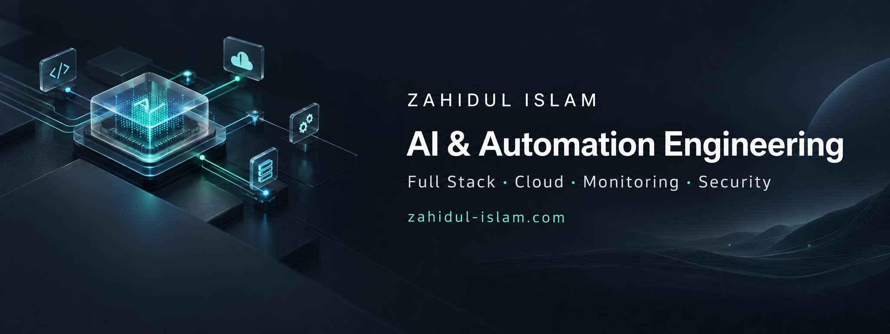

  

  <a href="https://zahidul-islam.com/"><strong>Portfolio & case studies</strong></a> ·
  <a href="https://www.linkedin.com/in/zahidul-islam-developer/">LinkedIn</a> ·
  <a href="https://www.upwork.com/freelancers/~015799bfae8562d0eb">Upwork</a>

I build AI assistants, automation workflows and full-stack applications, with cloud deployment, monitoring and security work. Based in **Dhaka, Bangladesh**, I am available for **remote projects and contract work**.

My earlier work as a Physiotherapy Technologist gives me additional context for healthcare and wellness projects. My engineering work also covers agency operations, commerce and developer tooling.

## What I build

| Area | Work |
| --- | --- |
| AI & automation | RAG assistants, n8n workflows, lead follow-up, content approval and API integrations |
| Full stack & commerce | Client portals, dashboards, backend services, WordPress/WooCommerce and Shopify development |
| Cloud & operations | Docker, Kubernetes, Terraform, CI/CD, deployment troubleshooting and monitoring configuration |
| Security | WordPress incident investigation and containment, access controls, security checks and recovery planning |

## Selected engineering projects

These public repositories show implementation, design decisions and verification records. Status matters: a demo, a configuration reference and a live client system are different kinds of evidence.

| Project | What to inspect | Current scope |
| --- | --- | --- |
| [Chronos](https://github.com/Zahidulislam2222/Chronos) | React/TypeScript storefront, custom WordPress plugins, WooCommerce integration and checkout handling | Connected commerce demo with **test payments** |
| [Kindred Grove](https://github.com/Zahidulislam2222/kindred-grove) | Shopify Liquid, Web Components, merchant-editable content and cart behavior | Development theme; latest work is in [PR #8](https://github.com/Zahidulislam2222/kindred-grove/pull/8), not the published theme |
| [MediConnect infrastructure](https://github.com/Zahidulislam2222/mediconnect-infrastructure-production) | Backend services, multi-cloud Terraform/Kubernetes, architecture and operations documentation | Retained engineering implementation; cloud runtime is inactive, not a live clinical service |
| [RAG reference stack](https://github.com/Zahidulislam2222/rag-production-stack) | LightRAG integration, Docker Compose, observability, security assessment and recovery configuration | Single-host reference; integration and runtime validation remain |
| [Secure Hybrid AI Hub](https://github.com/Zahidulislam2222/secure-hybrid-hub) | Python policy broker, scoped workspaces, model adapters and verification evidence | Experimental developer tool with synthetic tests; pre-production |
| [HealthCode Analysis](https://github.com/Zahidulislam2222/healthcodeanalysis) | Native WordPress/Elementor publication, browser tools and retained automation toolkit | Editorial and technology demonstration |

## Client work beyond the public repositories

- **Agency content workflow:** media intake, AI copy generation, client feedback, internal approval and controlled delivery for manual publishing.
- **Lead follow-up:** multi-site JotForm, n8n, Google Sheets and Twilio integration, with site routing and recorded send outcomes.
- **WordPress automation:** PHP/Python background jobs for validated AIOSEO metadata updates and per-item reporting.
- **RAG improvement:** retrieval and memory handling that separates user-authored facts from generated responses.
- **WordPress incident containment:** investigation, backup-first quarantine and recurrence checks after real page requests.

Public-safe project summaries are available in my [portfolio](https://zahidul-islam.com/). Client source code and sensitive operational details are not published here.

## Tools & technologies

| Area | Stack |
| --- | --- |
| AI, automation & agentic coding | Claude Code, Codex, MCP, n8n, OpenAI/Claude APIs, Pinecone, LightRAG |
| Frontend & backend | JavaScript, TypeScript, React, Next.js, Tailwind CSS, Python, FastAPI, Flask, Node.js, Express, PHP, REST APIs |
| Commerce & CMS | Shopify, Liquid, WordPress, WooCommerce, Contentful, Stripe |
| Data | PostgreSQL, Supabase, MongoDB, Redis, SQLite, DynamoDB |
| Cloud & DevOps | AWS, Google Cloud, Azure, Docker, Kubernetes, Terraform, GitHub Actions, Linux, Nginx |
| Monitoring & security | Prometheus, Grafana, Loki, Jaeger, Prowler, Checkov, Trivy, OWASP ZAP, Gitleaks, Semgrep, Bandit |

## Working together

I work through defined milestones and agreed acceptance checks. I test the relevant flows, document the handover and report remaining limitations. Each repository's own verification record explains what was tested and what still needs work.

For a project, send me the tools you use, what needs building or fixing, and the result you need through [LinkedIn](https://www.linkedin.com/in/zahidul-islam-developer/) or [Upwork](https://www.upwork.com/freelancers/~015799bfae8562d0eb).

I do not accept work involving interest-based finance (Riba), conventional insurance, gambling, adult content or any Haram activity.
